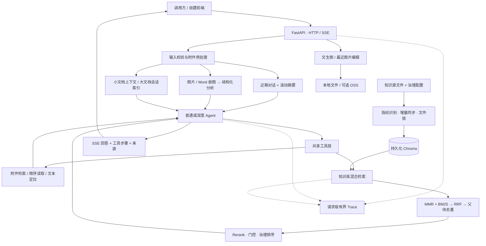

<div align="center">

# 全发 AI 助手

### 让平台知识可查询，让文档与图片可理解

**基于实习项目业务场景的个人复刻与工程化迭代**

本项目根据实习项目中的平台导览、知识问答与资料分析业务进行复刻，围绕真实业务问题，构建了集 **Agent 工具调用、混合 RAG、会话级附件检索、多模态分析与流式响应** 于一体的 AI 助手后端。这里展示的是复刻实现与技术迭代，不代表原实习项目的线上交付版本。


[项目亮点](#项目亮点) · [系统架构](#系统架构) · [快速开始](#快速开始) · [接口与联调](#接口与联调) · [测试与工程边界](#测试与工程边界)

</div>

---

## 为什么做这个项目

平台业务中，用户需要了解产品能力、找到操作入口、理解业务资料，还会带着文档或截图继续追问。单纯接入一个聊天模型，难以处理平台专有知识、长附件、多轮上下文和异常检索。

这个项目围绕四个问题展开：

| 业务问题 | 实现思路 |
| :--- | :--- |
| 通用模型不了解平台知识 | 本地知识库 + 混合检索 + 重排与质量门控 |
| 文档很长，直接塞 Prompt 成本高 | 小文档直接上下文，大文档建立会话级临时索引 |
| 用户会追问，也会上传图片和含图 Word 文档 | 会话记忆 + 视觉模型结构化分析 + 图文联合上下文 |
| Agent 可能重复检索，排错也难 | 无进展反思提示 + 请求级 Trace + 离线回归测试 |

> **仓库范围**：这是可独立启动的 Python AI 后端。原业务系统的 Vue 页面、Java 服务与 Android 工程不包含在此仓库；可通过 HTTP/SSE 接入自己的界面。

## 项目亮点

### 01 · 不只做向量检索：混合召回与父子分块

**向量 MMR + BM25（子块召回、父块扩展） → RRF 融合 → Rerank → 质量门控与知识治理**

- **双路召回**：向量通路处理语义相似，BM25 通路补充关键词、术语和精确名称；单路异常时仍可使用另一通路。
- **RRF 排名融合**：按两路排名聚合，而非直接相加不同量纲的分数。
- **Small-to-Big**：小块用于召回，命中后携带父块上下文；同一父块去重，不同文档的相同正文保留独立来源。
- **中文友好切分**：优先章节、段落、句子和子句边界，最后用字符级切分兜底。
- **关键词缓存**：分页构建只读快照，按索引 revision、业务日期、记录数量及 TTL 刷新；使用倒排结构减少重复计算。

实现入口：[检索流程](src/rag/search.py) · [父子分块](src/rag/documents.py) · [BM25](src/rag/bm25.py) · [关键词缓存](src/rag/keyword_cache.py)

### 02 · 让知识“有版本、有状态”：治理与增量同步

- 每份文档有独立 ID 与内容指纹；正文、治理元数据或切分配置变化时，仅同步受影响文档，未变化文档跳过 Embedding。
- 知识元数据支持负责人、权威等级、版本、状态、生效区间和原文链接；先过滤无效知识，再做召回和结果选择。
- 同步清单记录 `pending`，JSON 采用临时文件 + 原子替换；中断后重新同步可核对未完成文档。
- 新版完整写入后再清理旧版；文档快照和提交前指纹复核防止读到编辑中的半份内容。
- 检索与同步共用文件锁，使向量/BM25 两路读取同一版本；损坏配置或不匹配清单显式报错，而不是静默误删。

实现入口：[知识治理](src/rag/governance.py) · [增量同步](src/rag/embeddings.py) · [锁与原子写入](src/rag/sync_state.py)

### 03 · 检索结果有门槛，故障路径有区别

正常精排结果必须通过相关性阈值。低分、空结果或损坏响应被拦截，避免把明显不相关片段重新塞给模型；分数、索引、重复条目都有校验。

对于网络或服务可用性故障，实施超时与有界退避重试。精排服务不可用时，保留经过治理的 RRF 降级结果，并在 Trace 标记降级状态；**这条路径未通过精排阈值**，不与正常通过门控混淆。

实现入口：[质量门控](src/rag/search.py) · [策略说明](docs/rerank-quality-gate.md)

### 04 · 普通 / 深度模式，共享工具但区别执行策略

两种模式都通过 LangChain `create_agent` 使用同一组工具：

| 工具 | 解决的问题 |
| :--- | :--- |
| `rag_search` | 平台知识库问答，返回片段与来源 |
| `search_attachments` | 当前会话大文档的语义检索 |
| `read_attachment_chunks` | 按顺序读取文档，辅助全文概括 |
| `find_attachment_text` | 关键词、数字等文本精确定位 |

深度模式包装工具调用，记录输入与结果指纹。连续出现空结果、重复参数或重复输出时，追加反思提示，引导改参数、换工具、拆子问题或停止无效搜索；同时设置图执行递归上限。

> 普通 / 深度是两种执行模式，不是多个 Agent 并行协作。反思是基于规则触发的策略提示，不是独立评审模型或完整规划器。

实现入口：[普通 Agent](src/agent/normal/react_agent.py) · [深度 Agent](src/agent/deep/react_agent.py) · [反思机制](src/agent/deep/reflection.py)

### 05 · 附件不是一次性上下文：图文处理与跨轮追问

- 支持 `.txt`、`.md`、`.docx` 文档，以及 `.doc` 的兼容提取；旧版 Word 的效果受编码和文件结构影响。
- 小文档直接参与上下文；超过阈值的大文档建立会话 Chroma 索引，按需检索、顺序读取或文本定位。
- 提取 Word 嵌入图片，视觉分析结果按文档大小进入上下文或会话索引；图片数量等统计信息单独保留。
- 图片先分类，再使用对应 Prompt 输出结构化 JSON；通过解析回退与内容哈希缓存复用分析结果。
- 用 `conversation_id` 保持多轮问答；近期完整对话 + 滚动摘要共同构成记忆上下文。
- 支持文生图、基于最近生成图的编辑，以及本地 / OSS 存储切换。

实现入口：[附件与会话](src/attachments/session.py) · [视觉分析](src/media/analyze.py) · [会话记忆](src/memory/service.py) · [图片生成](src/media/generate.py)

### 06 · 流式响应与“可排查”的请求链路

SSE 不只输出回答 Token，也输出模式状态、工具步骤、来源与会话元数据。请求级 Trace 覆盖预处理、图片分析、记忆加载、检索候选、门控决策和 Agent 输出。

- `ContextVar` 隔离请求上下文，流式异常、取消和生成器关闭都有收尾处理。
- Trace 限制数量、TTL、步骤和载荷；记录来源定位信息而非知识块全文。
- 查询接口需运维 Bearer Token，默认关闭，响应禁止缓存。
- 诊断记录尽力保留，日志或序列化故障不应阻断主聊天链路。

实现入口：[SSE](src/agent/streaming.py) · [Trace](src/trace.py) · [访问控制与边界](docs/trace-hardening.md)

## 系统架构



## 快速开始

推荐 Python **3.11**，依赖版本见 [requirements.txt](requirements.txt)。聊天、Embedding、Rerank 和视觉能力需要自己的模型服务凭据；文本模型可用名称以服务商实际开通能力为准。

### 1. 获取项目

```bash
git clone https://github.com/anchen485-collab/ai-assistant.git
cd ai-assistant
```

### 2. 创建环境并安装依赖

<details>
<summary><strong>Windows / PowerShell</strong></summary>

```powershell
py -3.11 -m venv .venv
.\.venv\Scripts\python.exe -m pip install -r requirements.txt
Copy-Item .env.example .env
```

</details>

<details>
<summary><strong>Linux / WSL</strong></summary>

```bash
python3.11 -m venv .venv
source .venv/bin/activate
python -m pip install -r requirements.txt
cp .env.example .env
```

</details>

### 3. 配置模型与知识库

编辑 `.env`，先填写 `DASHSCOPE_API_KEY`。如使用其他兼容接口，再填写对应的 `OPENAI_COMPATIBLE_API_KEY` 和 Base URL。文本、视觉、图片生成与编辑的模型名均可配置。

| 配置 | 用途 |
| :--- | :--- |
| `DASHSCOPE_API_KEY` / `DASHSCOPE_BASE_URL` | 千问文本与相关模型服务；Embedding / Rerank 仍需 DashScope 凭据 |
| `OPENAI_COMPATIBLE_API_KEY` / `OPENAI_COMPATIBLE_BASE_URL` | 其他 OpenAI 兼容文本服务 |
| `MODEL_OPTIONS` / `DEFAULT_MODEL` | 可选文本模型与默认值 |
| `DEEP_AGENT_MAX_STEPS` / `DEEP_AGENT_TIMEOUT` | 深度模式执行与模型调用限制 |
| `KB_SOURCE_DIR` / `CHROMA_DIR` | 知识源目录与持久化索引目录 |
| `CHUNK_SIZE` / `CHUNK_OVERLAP` | 父块切分，按字符计数；默认 800 / 100 |
| `RETRIEVAL_K` / `RERANK_FETCH_K` / `RERANK_THRESHOLD` | 返回数、候选数与门控阈值；默认 5 / 10 / 0.3 |
| `ATTACHMENT_INDEX_THRESHOLD_CHARS` | 大文档会话索引阈值；默认 1000 字符 |
| `MEMORY_SUMMARY_ROUNDS` / `MEMORY_RECENT_ROUNDS` | 摘要触发与近期保留轮数；默认各 5 |
| `TRACE_API_TOKEN` | 运维查询令牌，至少 32 字符；不填则关闭查询 |
| `IMAGE_GENERATION_*` / `IMAGE_EDIT_*` | 图片生成与编辑；业务空间地址按实际配置 |
| `OSS_ENABLED` / `OSS_*` | 可选对象存储；本地开发默认关闭 |

知识库从 `KB_SOURCE_DIR` 顶层读取 `.txt`、`.md`、`.docx`，并要求有效的 `knowledge_metadata.json`。原文与治理字段同时进入索引；配置方法见 [知识治理说明](docs/knowledge-governance.md)。

> 首次构建及文档变化会调用在线 Embedding。更换 Embedding 模型或从旧版索引升级时，建议使用新的 `CHROMA_DIR` 重建，保留旧库与清单的配套备份。当前同步按启动预热 / 检索触发，不包含后台文件监听任务。

### 4. 启动服务

Windows：

```powershell
.\.venv\Scripts\python.exe -m uvicorn app:app --host 127.0.0.1 --port 8000 --reload
```

Linux / WSL（已激活环境）：

```bash
python -m uvicorn app:app --host 127.0.0.1 --port 8000 --reload
```

- 健康检查：<http://127.0.0.1:8000/api/health>
- 交互式接口文档：<http://127.0.0.1:8000/docs>

预热失败不阻塞 API 服务启动；健康检查成功仅说明服务可响应，不代表模型或知识库已经验收通过。

## 接口与联调

### 主要接口

| 方法 | 路径 | 功能 |
| :--- | :--- | :--- |
| `GET` | `/api/health` | 健康检查 |
| `GET` / `POST` | `/api/models` / `/api/models/switch` | 文本模型列表 / 校验模型选择 |
| `POST` | `/api/chat/stream` | 普通或深度模式 SSE 聊天 |
| `POST` | `/api/attachments/images` | 上传图片，返回附件 ID |
| `POST` | `/api/attachments/files` | 上传文档，返回附件 ID |
| `GET` / `DELETE` | `/api/attachments/{attachment_id}` | 读取 / 删除附件 |
| `DELETE` | `/api/sessions/{session_id}` | 清理会话附件索引 |
| `POST` | `/api/images/generate` | 图片生成或基于会话历史编辑 |
| `GET` | `/api/generated-images/{image_id}` | 读取生成图片 |
| `GET` | `/api/traces` / `/api/traces/{trace_id}` | 受保护的诊断查询 |

当前聊天入口为 `/api/chat/stream`，没有独立的 `POST /api/chat` 路由。切换模型接口用于校验和返回模型名；具体聊天模型由请求中的 `model` 或默认配置决定，不持久修改服务默认值。

### 发起一次流式问答

```bash
curl -N http://127.0.0.1:8000/api/chat/stream \
  -H 'Content-Type: application/json' \
  -d '{"question":"请介绍平台的主要能力","mode":"normal","conversation_id":null,"attachment_ids":[]}'
```

需要深度分析时将 `mode` 改为 `deep`；下一轮复用响应 `metadata` 中的 `conversation_id`。指定会话 ID 时应使用合法 UUID。

| SSE `type` | 含义 |
| :--- | :--- |
| `meta` | 本轮 `trace_id` |
| `status` | 模式与模型等状态 |
| `delta` | 回答增量文本 |
| `step` | 工具调用步骤 |
| `metadata` | 来源、步骤、会话 ID、附件等 |
| `error` / `done` | 错误提示 / 流结束 |

带附件提问时，先以 multipart 字段 `file` 调用上传接口，再将返回 ID 放入 `attachment_ids`。默认单文件上限 5 MB；图片上传支持 JPEG、PNG、WebP。PDF 不在当前解析范围。

### 接入前端与反向代理

服务本身使用 `/api/*`。原业务前端使用 `/agent-api` 代理前缀，联调时将该前缀转发到 FastAPI，并重写为 `/api`；保留 Java 业务的 `/api` 路由，不与 AI 服务混用。SSE 代理需要关闭响应缓冲，并配置合适的连接超时。当前 CORS 允许本机 5173 端口。

## 项目结构

```text
ai-assistant/
├── app.py                       # API、SSE、附件预处理与 Trace 权限
├── requirements.txt             # 运行依赖
├── .env.example                 # 配置模板，不含真实凭据
├── src/
│   ├── agent/                   # 普通 / 深度模式、反思、流式适配
│   ├── attachments/             # 上传、Word 解析、会话索引与读取工具
│   ├── core/config.py           # 模型路由与集中配置
│   ├── media/                   # 图片分类、分析、缓存、生成与编辑
│   ├── memory/                  # JSON 会话存储与滚动摘要
│   ├── rag/                     # 父子分块、混合检索、同步、治理与缓存
│   │   └── data/                # 知识源与治理元数据
│   ├── storage/oss.py           # 可选 OSS 存储适配
│   ├── tools/rag.py             # Agent 工具集入口
│   └── trace.py                 # 有界内存诊断缓存
├── tests/                       # 当前离线单元 / 组件 / Chroma 回归测试
└── docs/                        # 各模块设计、故障恢复与部署边界
```

## 测试与工程边界

### 172 项离线回归测试

2026-10-12，在已有 Python 3.11 项目环境中执行 `unittest`：**172 项测试通过**。覆盖 BM25 公式与边界、父块去重、单路故障、知识生效期、损坏配置、增量恢复、读写锁、真实临时 Chroma、精排响应校验，以及 Trace 访问控制和 SSE 取消路径。

```bash
python -m pip install httpx
python -m unittest discover -s tests -v
```

Windows 可使用 `.\.venv\Scripts\python.exe` 替换上述 `python`。测试以本地测试向量或网络桩隔离在线服务，不消耗真实模型调用额度。

**这些结果证明已覆盖相应代码路径，不等同于真实模型准确率、完整前后端验收或生产压测。** 当前没有声明检索准确率、延迟优化百分比或线上吞吐指标；全新环境依赖安装也需独立验证。历史 `Test/` 目录保留旧接口实验，当前回归入口使用 `tests/`。

### 当前工程取舍

| 已实现 | 当前边界 |
| :--- | :--- |
| 文档级增量同步、互斥锁与中断恢复 | 面向单机持久化目录；建议单应用进程，不承诺多实例缓存一致性 |
| 规则反思与执行递归限制 | 不是完整的目标进度状态机，也没有通用自动规划器 |
| 来源返回与质量门控 | 来源集合不等于每句话的引用核验；精排降级需单独识别 |
| 会话 JSON 存储、摘要与附件索引 | 不具备完整的租户鉴权；UUID 是会话标识，不是权限凭据 |
| 受保护的 Trace 查询 | 内存缓存重启清空，非集中式持久化审计系统 |
| 附件生命周期清理 | 服务关闭会清理会话附件索引和本地上传目录，应提前设计保留策略 |

公开部署前，请补齐业务接口鉴权、会话/附件资源权限、网关限流、HTTPS 和真实模型联调；对业务资料与自由文本进行必要的脱敏。真实 Key、用户上传、生成结果、会话记录和运行索引留在本地或受控存储，不进入提交。

### 进一步阅读

- [混合检索与缓存设计](docs/hybrid-retrieval-hardening.md)
- [知识治理策略](docs/knowledge-governance.md)
- [增量同步、故障恢复与部署建议](docs/rag_sync_hardening.md)
- [重排与质量门控](docs/rerank-quality-gate.md)
- [Trace 稳定性与访问控制](docs/trace-hardening.md)

---

<div align="center">

**从实习业务场景出发，把“能回答”迭代为“有依据、可追踪、可维护”。**

</div>
